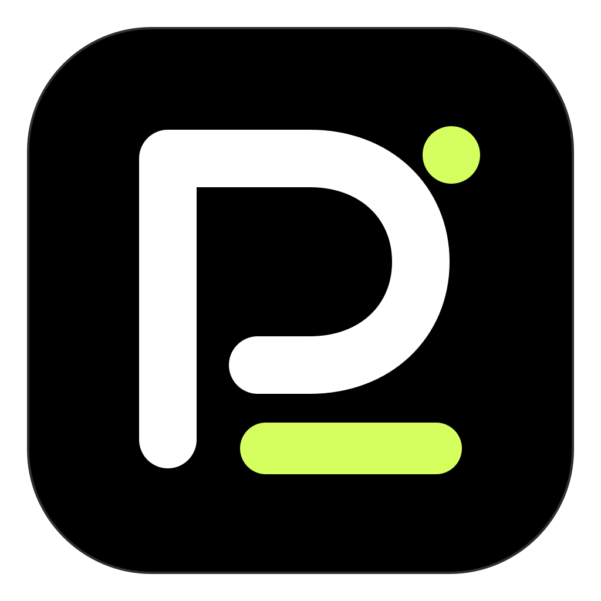

<p align="center">
  
</p>

<h1 align="center">Providock</h1>

<p align="center">
  <strong>一个桌面看板，掌握 AI Agent 用量、模型成本与账户额度。</strong>
</p>

<p align="center">
  本地优先 · macOS &amp; Windows · 九种 Agent 数据源
</p>

<p align="center">
  <a href="https://github.com/Abyssaler/Providock/releases/latest"></a>
  <a href="https://github.com/Abyssaler/Providock/actions/workflows/ci.yml"></a>
  <a href="LICENSE"></a>
</p>

<p align="center">
  <a href="https://github.com/Abyssaler/Providock/releases/latest">下载</a> ·
  <a href="#功能">功能</a> ·
  <a href="#快速开始">快速开始</a> ·
  <a href="#开发">开发</a> ·
  <a href="https://github.com/Abyssaler/Providock/issues">反馈问题</a>
</p>

Providock 将散落在不同 AI 编程工具中的用量记录汇集到本机：查看 Token 消耗与缓存效果，按模型估算成本，并单独管理 API 余额和 Coding Plan 额度。无需改动现有 Agent 配置，也不需要 Providock 云服务。

## 功能

- **用量看板**：输入、输出、缓存创建、缓存命中与命中率，配合趋势图、模型/Agent 汇总和分页明细。
- **灵活筛选**：按 Agent、数据源、模型和时间查看；支持当天、最近 1/3/6 小时、7/30 天、全部时间及自定义日期时间。
- **模型成本**：自定义 CNY/USD 价格，支持分时段与长上下文定价；从 AIHOT 或官网链接获取候选报价，核对后保存。
- **账户额度**：独立展示 API 余额、订阅窗口剩余比例与重置时间，不要求账户绑定 Agent。
- **会话与数据源**：检索会话、查看用量分解，检查数据源兼容状态与最近同步时间；部分来源支持按需查看正文。
- **后台常驻**：macOS 菜单栏、Windows 托盘，关闭窗口后继续按设置采集；支持应用内检查更新。

## 下载

当前版本：**v2.2.0**。

| 平台                      | 下载                                                                                                          | 安装方式                     |
| ------------------------- | ------------------------------------------------------------------------------------------------------------- | ---------------------------- |
| macOS 13+ · Apple Silicon | [下载 DMG](https://github.com/Abyssaler/Providock/releases/download/v2.2.0/Providock_2.2.0_aarch64.dmg)       | 打开后拖入「应用程序」       |
| Windows 11 · x64          | [下载安装程序](https://github.com/Abyssaler/Providock/releases/download/v2.2.0/Providock_2.2.0_x64-setup.exe) | 运行安装程序，安装到当前用户 |

[全部版本与校验文件](https://github.com/Abyssaler/Providock/releases) · [变更记录](CHANGELOG.md)

安装包附 SHA-256 校验和及 minisign 签名。目前尚无 Apple Developer ID 公证和 Windows Authenticode 签名，系统可能提示未知发布者，请使用本仓库 Releases 提供的文件。

已有 v2.0.3 或更高版本，可在「设置 → 软件更新」检查并手动下载安装；更早版本需手动安装。v1 的账户与统计不会自动迁移到 v2。

## 快速开始

1. **打开应用**：默认自动发现并同步本机已有 Agent 日志；也可在用量页点击「立即同步」。
2. **选择统计范围**：筛选 Agent、模型和时间，在「模型定价」中设置价格以查看成本估算。
3. **添加账户（可选）**：在账户页选择平台与凭据，保存后点击「立即验证」，查看余额或订阅额度。

「设置 → Agent 显示」可选择看板中的 Agent；「设置 → 采集与刷新」可分别控制自动同步与账户刷新。默认 Agent 每 60 秒同步，API 余额约每 15 分钟、Coding Plan 约每 5 分钟刷新。用量页的「显示刷新」只更新看板显示。

关闭窗口后应用继续运行。Windows 左键托盘图标或右键「打开 Providock」恢复窗口，右键「退出 Providock」完全退出；macOS 从菜单栏恢复，使用菜单栏退出或 ⌘Q 完全退出。

## 支持的 Agent

Providock 读取以下工具的本地日志或数据库：

**Claude Code · Codex · Gemini CLI · Grok Build · OpenCode · Pi · MiniMax Code（MCode） · Kimi Code · DeepSeek Harness**

只统计本机已有且格式兼容的记录，未安装的工具无需配置。各 Agent 的原生平台支持、可用字段及日志格式不同；DeepSeek Harness 当前支持 session v3/v4，包括 `.zstd`。具体版本范围见[兼容说明](docs/research/compatibility-register.md)。

## 账户与额度

| 平台                     | 可查询内容                                           |
| ------------------------ | ---------------------------------------------------- |
| DeepSeek                 | API 余额                                             |
| OpenRouter               | 当前 Key 的用量/预算；账户 Credits 需管理密钥        |
| Novita                   | 可用余额、现金及授信信息                             |
| GLM / 智谱               | Coding Plan 额度                                     |
| Kimi Code                | Coding Plan 额度，支持 Coding Key 或本机 Server 通道 |
| New API / One API 中转站 | Key 额度或个人账户余额；需配置站点及凭据权限         |
| Codex / ChatGPT          | 当前本机 ChatGPT 登录的订阅额度窗口，无需 API Key    |

Codex 额度需要本机可调用的官方 Codex CLI，并已使用 ChatGPT 登录；API Key 登录不提供订阅额度。CLI 未自动找到时，可通过 `CODEX_CLI_PATH` 指定路径。其他账户的查询范围取决于平台、区域及凭据权限，详见[账户说明](docs/specs/ACCOUNT_ADAPTERS.md)。

**本机用量与平台额度分开展示。** 平台额度可能包含其他设备或成员的使用；模型成本是按所设价格计算的估算，不等同账单。未知数据与价格保留未知，不按零处理；不同币种分别统计。

## 模型价格

在「模型定价」选择 Agent 和精确模型名后，可手动填写费率，或点击「从 AIHOT 导入」获取该模型的报价。也可提供公开 HTTPS 官网计费链接，由程序读取价格表；结果均需核对后保存。

选择 CNY/USD 及标准实时/Batch 后解析。已适配 MiMo、DeepSeek 和智谱的合并单元格、横表、分时段与输入/输出组合分档；按小时缓存存储不混入 Token 价格。节假日排除目前覆盖 2026 年，缺条件或未覆盖的工作日不猜价。

中转站账户请按 New API / One API 协议添加 HTTPS 根地址（不含 /v1）；推理 Key 的额度与账户余额分开。个人访问令牌查询需用户 ID，换算为现金前需向站点确认每 CNY/USD 对应额度；默认显示原始站点额度。

程序无法识别时，可主动选择已有 DeepSeek、GLM 或 OpenRouter API 账户和模型辅助解析。此操作仅发送公开价格页文本与目标模型，产生一次 API 调用费用，不运行工具或 Agent 循环。动态页面、复杂分档或信息缺失时可能需要手动填写。

## 数据与隐私

- **数据在本机**：统计保存在本地 SQLite，不上传 Agent 日志；采集只读源文件，不修改 Agent 配置、不发起模型调用。
- **正文默认关闭**：启用后按需从源文件读取；当前支持 Claude Code、Codex 和 Kimi Code 的部分格式，不自动加载远程资源或执行脚本。
- **凭据本地明文保存**：API Key 独立存放于应用数据目录的 `credentials/keys.sqlite3`，受本地文件权限保护，未加密。完整备份应用数据目录会包含凭据。
- **网络按功能使用**：账户刷新访问对应平台，价格获取读取公开页面，软件更新访问 GitHub；模型辅助解析仅在主动点击后调用所选 API。

更多细节见[隐私说明](docs/specs/SECURITY_PRIVACY.md)。

## 开发

开发环境：**Node.js 24 · pnpm 12.11.2 · Rust 1.99.0**，使用仓库固定的版本及锁文件。系统依赖参考 [Tauri 开发环境](https://v2.tauri.app/start/prerequisites/)。

```bash
git clone https://github.com/Abyssaler/Providock.git
cd Providock
pnpm install --frozen-lockfile
pnpm tauri dev
```

`pnpm dev` 仅预览前端，不包含桌面原生功能。测试、构建及贡献约定见[开发手册](docs/DEVELOPMENT_HANDBOOK.md)和 [AGENTS.md](AGENTS.md)。

欢迎通过 [Issues](https://github.com/Abyssaler/Providock/issues) 反馈问题或建议，通过 [Pull Requests](https://github.com/Abyssaler/Providock/pulls) 提交改进。报告问题时请附系统、应用版本和复现步骤，并移除密钥、令牌及私密对话。

## 兼容性

macOS ARM64 与 Windows x64 均有 CI 检查和安装包构建。Windows 托盘交互已在实机验证，完整安装/更新、所有缩放与休眠场景仍在完善；不同 Agent 与账户的验证范围见[兼容说明](docs/research/compatibility-register.md)。

Claude Desktop 网关转发、统计导出/清理界面及更多正文格式仍在开发中，当前版本不提供这些完整功能。

## 许可证

[MIT](LICENSE)。上游项目与第三方组件说明见 [THIRD_PARTY_NOTICES.md](THIRD_PARTY_NOTICES.md)。
