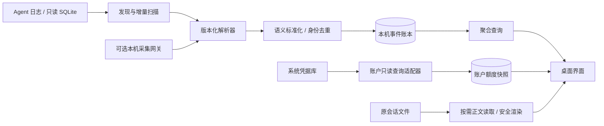

# 架构设计

## 1. 技术选择

采用 Tauri 2 桌面壳、Rust 后端、React + TypeScript + Vite 前端、SQLite 本地存储。理由是只读文件/数据库采集、系统凭据库、低常驻开销和两平台安装支持。界面使用 Tailwind 与轻量无障碍组件，图表采用能在系统 WebView 工作的库。具体依赖版本在搭建时锁定，不在本文虚构“最新版”。

Rust 侧承担采集、账户 HTTP、凭据访问、Token 标准化、持久化、聚合和导出。前端只接收脱敏 DTO、分页数据和任务状态；不持有 HTTP 鉴权信息。账户 adapter、Agent adapter、网关 parser 共享标准契约，彼此不共享隐式配置。

## 2. 数据流



用量账本属于本机；额度快照属于平台账户。二者仅通过可选人工关联相连，没有自动余额扣减逻辑。

## 3. 计划目录

以下为未来实现目录，当前不代表文件已存在。

```text
src/
  app/                 # 路由、壳、主题
  features/usage/      # 总览、趋势、分页明细
  features/accounts/   # 独立账户列表与额度窗口
  features/sessions/   # 会话与可选正文
  features/sources/    # 采集状态与兼容信息
  components/          # 通用卡片、空状态、配额条
  contracts/           # 从 Rust 类型生成的 DTO
src-tauri/src/
  domain/              # UsageEvent、QuotaWindow、Money、Evidence
  adapters/agents/     # 八个 Agent 的独立适配器
  adapters/accounts/   # 平台、区域、认证类型适配器
  adapters/content/    # 各源的正文映射，独立于统计
  ingestion/           # 发现、文件监视、轮询、游标、事务、去重
  gateway/             # 可选转发、协议 usage 解析
  storage/             # 自有数据库与 migrations
  vault/               # macOS Keychain / Windows 凭据库
  services/            # 聚合、调度、导出、删除、价格
  commands/            # 有限 Tauri IPC
fixtures/              # 合成或经授权脱敏的版本化样本
docs/                  # 本设计、证据与验收
```

## 4. Adapter 接口

Agent 适配器提供 `detect_roots`、`detect_format`、`scan_incremental`、`capabilities`。输入为已核准的根目录、格式版本、旧游标；输出为候选事件、会话索引更新、新游标及诊断。纯解析函数不操作用户配置、不写源文件、不访问凭据库。

正文适配器提供 `list_messages(session_ref, cursor, limit)`，返回安全内容块及后续游标；无需正文权限即可运行统计适配器。会话分叉的可见消息链与计费事件账本分别建模。

账户适配器提供 `capabilities(account_config)` 和 `query(credential_handle)`。能力包括现金余额、赠金、用量、额度窗口、到期时间；返回结构化快照及字段来源。解析是可测试的纯函数，HTTP 与凭据注入在服务层。每个平台显式规定 host、path、method、认证头、响应单位、证据级别、超时和兼容版本。

网关提供每个 wire protocol 的 usage 解析器：Anthropic Messages、OpenAI Chat Completions、Responses 等按已实现协议注册。先保证 Claude Desktop 模型映射所需协议；不宣称自动覆盖全部协议。流式请求转发时按协议完成/增量语义合并 usage，而不是累加每个重复快照。

## 5. 同步与一致性

首次扫描发现历史，随后文件监视提示增量扫描；监视不能保证可靠，因此同时保留低频目录对账。拟定活跃源 2 秒去抖、30 秒补扫，未发现源每 5 分钟检查，均可调整。扫描在有界后台任务中执行，不阻塞 UI。

一次提交事务包含事件 upsert、身份表、会话更新、游标更新；其中任一步失败全部回滚。文件游标记录源实例、文件身份、代数、字节偏移、尾部校验和解析器版本。未写完的 JSONL 尾行不推进已提交偏移；轮转、截断、文件替换重新发现，重新扫描靠身份去重保障。

源 SQLite 用只读连接、短事务和有界 busy timeout。尊重活动 WAL，不能用 immutable=1 假设数据库不会变化，不能 checkpoint、VACUUM 或 migrate 源数据库。自有数据库使用 WAL、单写入队列、参数化 SQL 和版本化迁移。

解析器升级在新的 parse_run 中重建该源派生记录，成功后事务切换活跃版本，失败保留旧数据；聚合按当前活跃版本计算。禁止新旧解析结果同时计入。

## 6. IPC 与前端状态

计划命令：`usage_summary`、`usage_series`、`usage_events_page`、`sessions_page`、`session_content_page`、`sources_list`、`source_update`、`sync_start`、`sync_cancel`、`accounts_list`、`account_save`、`account_refresh`、`account_delete`、`export_statistics`、`gateway_status`、`gateway_start`、`gateway_stop`。

保存凭据命令只接受输入、不返回秘密；不提供“列出所有明文 Key”命令。状态事件为采集进度、账本版本变化、账户刷新完成和错误代码，消息中不含原始响应或正文。前端查询键包括筛选、时区、活跃账本版本，避免切换时显示旧范围数据。

筛选条件与分页类型在共享契约生成，统计从 Rust 获取；前端仅进行显示格式化，避免 JavaScript 浮点和不同页面计算口径不一致。

## 7. 可选采集网关

仅绑定 loopback，使用随机本机访问令牌、显式目标 host allowlist；禁止公网监听和任意目标转发。目标认证由网关专属凭据配置管理，不能偷偷复用账户管理凭据。保留流式回压、取消、超时、错误、工具调用和非文本内容。默认关闭请求/响应正文落盘。

网关只保证捕获经过它的响应所报告 usage；断流或上游不返回 usage 时标记不完整。不能靠 tokenizer 结果冒充上游精确计量。为避免额外计费，默认不自动重试已开始发送的推理请求。

能匹配 provider request ID、原始 request ID 或显式传递 correlation ID 时将网关与日志事件归并为同一个逻辑事件的多个证据；不能可靠匹配时，网关作为单独流量域展示，默认总览仍按本地账本，用户可切换“仅网关”。不得按相近时间和相同 Token 强行合并。

## 8. 质量与性能目标

目标数据集为 100 万条标准事件。已索引聚合 p95 < 500ms、增量事件在源落盘后通常 5 秒内显示、空闲 CPU 平均 < 1%、RSS 目标 < 200MB；这些是待基准验证目标。记录测试设备、系统、数据规模和冷/热缓存。大文件流式处理，不加载整文件；消息分页，不渲染完整对话。没有达到目标时披露测量值，不虚报通过。

结构化诊断只记录适配器、错误码、文件匿名 ID 和计数；便于定位未知格式，但不泄露路径、Key 或对话。默认无遥测和远程错误上传。
